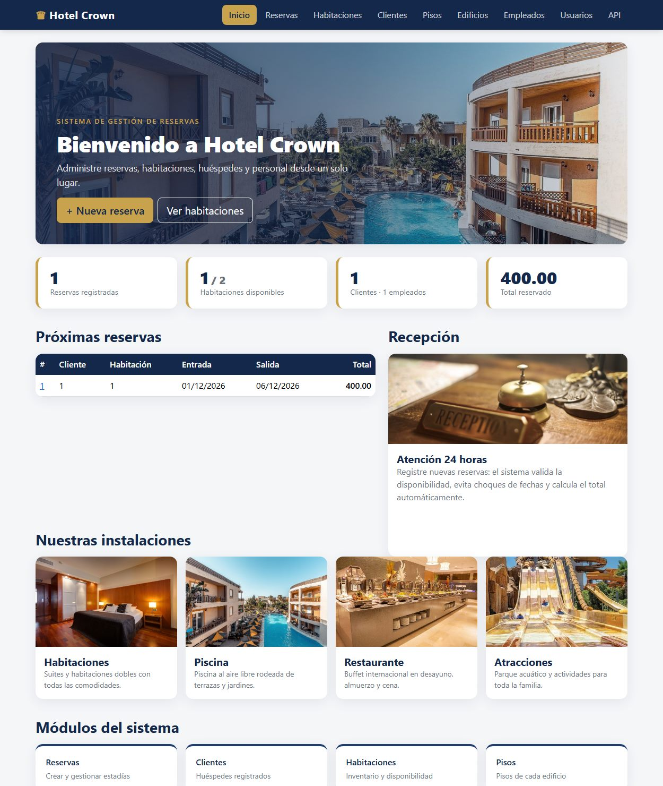

# Hotel Crown — Sistema de Gestión de Reservas de Hoteles

Aplicación ASP.NET Core (.NET 10) con arquitectura por capas: web MVC + API REST, lógica de negocio, acceso a datos con Entity Framework Core y dominio.

## Entregas

| Entrega | Documento |
|---|---|
| Práctica de refactorización — Diagnóstico y propuesta | [docs/01-Diagnostico-y-Propuesta.pdf](docs/01-Diagnostico-y-Propuesta.pdf) ([md](docs/01-Diagnostico-y-Propuesta.md)) |
| Práctica de refactorización — Evidencias de verificación | [docs/02-Evidencias-de-Verificacion.pdf](docs/02-Evidencias-de-Verificacion.pdf) ([md](docs/02-Evidencias-de-Verificacion.md)) |
| Desarrollo de la capa de API | [docs/03-Capa-de-API.pdf](docs/03-Capa-de-API.pdf) ([md](docs/03-Capa-de-API.md)) |
| Salidas de compilación, pruebas y llamadas a la API | [docs/evidencias/](docs/evidencias/) |

## Interfaz

Panel de inicio con indicadores, próximas reservas, instalaciones del hotel y acceso a cada módulo. Cada sección (Reservas, Habitaciones, Clientes, Pisos, Edificios, Empleados, Usuarios) tiene listado, detalle, alta, edición y baja; el formulario de reserva usa listas de clientes y habitaciones y muestra el motivo cuando una regla de negocio la rechaza.



Las imágenes del hotel están en `HotelApp.W/wwwroot/Imagenes/Hotel/`; la interfaz usa copias optimizadas para web en la subcarpeta `web/`.

## Estructura

| Proyecto | Responsabilidad | Depende de |
|---|---|---|
| `HotelManagement.Entities` | Dominio: entidades y reglas propias de la reserva | — |
| `HotelManagement.BL` | Servicios de negocio y contratos de repositorio (`Repositorios/`) | Entities |
| `HotelManagement.DAL` | `HotelDbContext` y repositorios EF que implementan los contratos | BL, Entities, EF Core |
| `HotelApp.W` | Web MVC (`Controllers/`, `Views/`) y API REST (`Api/`); registra las dependencias | BL, DAL, Entities |
| `HotelManagement.Tests` | Pruebas de reglas de negocio **sin base de datos** | BL, Entities |
| `HotelManagement.IntegrationTests` | Compatibilidad del esquema y flujo con repositorios reales | DAL, BL, Entities |

## Ejecutar

Requisito: .NET SDK 10.

```bash
dotnet build "Gestion del Hotel Crown.slnx"
dotnet test  "Gestion del Hotel Crown.slnx"

cd HotelApp.W
dotnet run --launch-profile http
```

- Web: <http://localhost:5280>
- API (Swagger): <http://localhost:5280/swagger>
- Demostración de todos los endpoints: `powershell -ExecutionPolicy Bypass -File docs\demo-api.ps1`

### Base de datos

- **Desarrollo:** SQLite en `HotelApp.W/Crown.db`; se crea sola al iniciar, sin instalar nada.
- **Producción / SQL Server:** en `appsettings.json`, `"DatabaseProvider": "SqlServer"` y la cadena `DefaultConnection` (por defecto LocalDB, base `Crown`). Para usar SQL Server también en desarrollo, cambie `"DatabaseProvider"` a `"SqlServer"` en `appsettings.Development.json`.
