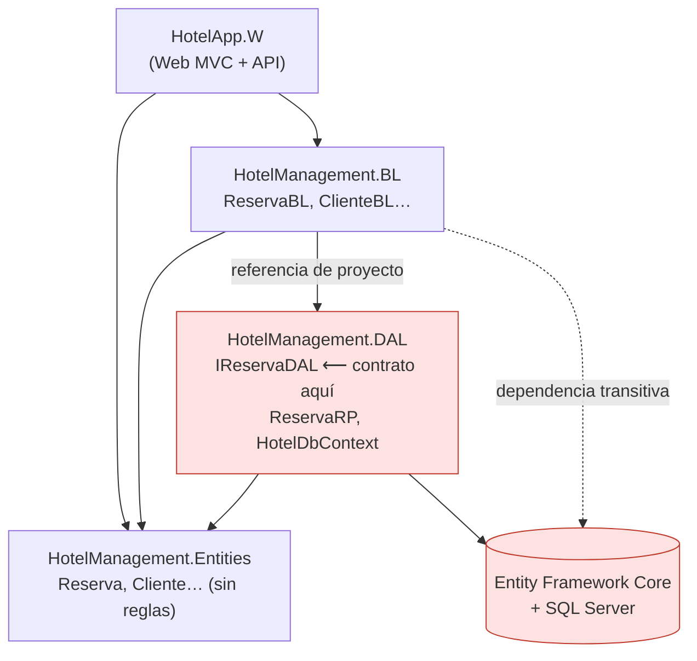
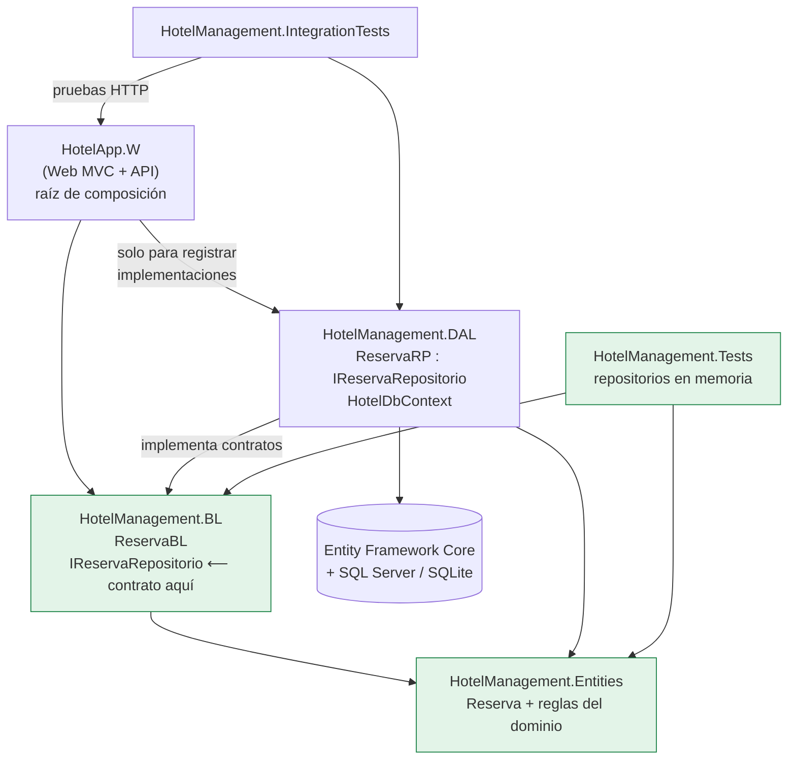

# Práctica de refactorización — Diagnóstico y propuesta

**Sistema de Gestión de Reservas de Hoteles (Hotel Crown)**
Rama: `refactor/capa-api-y-desacoplamiento`

---

## 1. Pregunta del caso

> *Si cambiara la forma en que el sistema guarda las reservas, ¿qué partes del código se verían afectadas y por qué?*

**Antes del refactor** se veían afectadas **cuatro capas**, no solo la de datos:

| Parte afectada | Por qué |
|---|---|
| `HotelManagement.DAL/Repositories/ReservaRP.cs` y `Context/HotelDbContext.cs` | Es donde realmente se guarda la reserva (esperado). |
| `HotelManagement.DAL/Interfaces/IReservaDAL.cs` | El contrato del repositorio vivía **dentro** de la capa de datos: cambiar la persistencia podía obligar a cambiar el contrato. |
| `HotelManagement.BL/Service/ReservaBL.cs` y `HotelManagement.BL.csproj` | La lógica de negocio **referenciaba el proyecto DAL** (y con él Entity Framework y SQL Server). Cualquier cambio en la DAL obligaba a recompilar y volver a probar el negocio. |
| `HotelApp.W/Program.cs` y cualquier prueba | Cualquier proyecto de pruebas del negocio arrastraba en compilación Entity Framework y SQL Server, y el contrato que había que simular (`IReservaDAL`) pertenecía a la capa de datos: las pruebas del negocio quedaban atadas a la persistencia. |

**Después del refactor** solo cambia la DAL (y su registro en `Program.cs`): el negocio depende de una interfaz que él mismo define.

---

## 2. Diagnóstico: cómo se relacionaban dominio y persistencia

### 2.1 Ejemplos concretos del repositorio (commit `f213dc3`)

**a) El negocio dependía del proyecto de datos.** `HotelManagement.BL.csproj`:

```xml
<ProjectReference Include="..\HotelManagement.DAL\HotelManagement.DAL.csproj" />
```

y `ReservaBL.cs` importaba directamente la capa de datos:

```csharp
using HotelManagement.DAL.Interfaces;      // el contrato vive en la DAL
public class ReservaBL : IReservaBL
{
    private readonly IReservaDAL _reservaDAL;  // dependencia hacia "abajo"
```

Como `HotelManagement.DAL` referencia `Microsoft.EntityFrameworkCore.SqlServer`, **todo proyecto que usara el negocio arrastraba Entity Framework y SQL Server**.

**b) No existían reglas de negocio de reservas.** `ReservaBL` solo reenviaba llamadas:

```csharp
public async Task CrearAsync(Reserva reserva)
{
    await _reservaDAL.CrearAsync(reserva);   // sin ninguna validación
}
```

Prueba ejecutada sobre la API **antes del refactor** (commit `f107cb3`: el código del equipo más únicamente los arreglos mínimos para que arrancara, como declarar las claves primarias; ninguna lógica de negocio cambiada). Se aceptó una reserva con **salida antes de la entrada y total negativo**:

```
POST /api/ReservaApi  {"fechaEntrada":"2026-12-05","fechaSalida":"2026-12-01","total":-5}
→ 200 {"mensaje":"Reserva creada correctamente"}
```

**c) Cada entidad persistía de una forma distinta, mezclada con el negocio.**

| Entidad | Dónde se “guardaba” en realidad |
|---|---|
| Reserva, Build, Piso, Usuario | Base de datos con EF (`HotelDbContext`) |
| Empleado, Habitación | `static List<>` dentro del repositorio (`EmpleadoRP`, `HabitacionRP`) — se perdían al reiniciar |
| Cliente | `static List<Cliente>` **dentro de la capa de negocio** (`ClienteBL`), que además ignoraba el repositorio que recibía (`_ClienteDAL` nunca se usaba) |

La capa de negocio de Cliente **era** su propia persistencia: imposible cambiar la forma de guardar clientes sin reescribir el negocio.

**d) Dos definiciones distintas del esquema.** En la DAL convivían el mapeo de EF y consultas SQL escritas a mano (`DATSQL/`) que no coinciden:

| Concepto | EF (`HotelDbContext`) | SQL manual (`DATSQL/ReservaSQL.cs`, `UsuarioSQL.cs`) |
|---|---|---|
| Tabla de reservas | `Reservas` (con `Total`) | `Reserva` (sin `Total`) |
| Usuario | `NombreUsuario`, `Clave` | `Username`, `PasswordHash` |
| Cliente | `Correo` | `Email` |

Además `DBConnection.cs` tenía la cadena de conexión fija en código.

**e) Consecuencia para las pruebas.** No había proyecto de pruebas. Probar una regla de reserva exigía un `HotelDbContext` y, por lo tanto, SQL Server.

### 2.2 Dependencias ANTES del refactor



La flecha **BL → DAL** es el problema: el negocio (política) depende del detalle técnico (persistencia).

---

## 3. Alternativas consideradas

| # | Alternativa | Ventajas | Desventajas | Decisión |
|---|---|---|---|---|
| A | **Dejarlo igual y usar mocks** (Moq) de `IReservaDAL` en las pruebas | Cambio mínimo | El negocio sigue referenciando la DAL y EF; el contrato sigue en la capa de datos; no resuelve el acoplamiento, solo lo oculta en las pruebas | Descartada |
| B | **Proveedor EF InMemory** para las pruebas | Sin servidor SQL | Sigue dependiendo de EF; no es “sin base de datos”, solo otra base de datos; se comporta distinto a una relacional | Descartada |
| C | **Arquitectura limpia completa** (proyectos Domain / Application / Infrastructure, modelos de persistencia separados del dominio y mapeadores) | Separación máxima | Renombrar y duplicar proyectos y modelos; mucho cambio para el equipo y el plazo; el beneficio extra no es necesario porque `Entities` ya no depende de EF (el mapeo está en el `DbContext` con Fluent API) | Descartada por costo |
| D | **Inversión de dependencias (patrón Repositorio + puertos)**: el negocio define las interfaces de repositorio; la DAL las implementa; la Web compone | Elimina BL → DAL; reglas probables con repositorios falsos; conserva los proyectos, nombres de clases y esquema existentes | Requiere que la Web referencie la DAL para registrar implementaciones (es su papel de raíz de composición) | **Elegida** |
| E | **Proyecto de contratos aparte** (`HotelManagement.BL.Contracts` con solo las interfaces de repositorio) | La DAL no vería los servicios de negocio, solo los contratos | Un proyecto más; para el tamaño actual no aporta una separación adicional verificable, y puede extraerse después sin tocar el negocio | Descartada por ahora (evolución natural de D) |

### Por qué D

1. **Resuelve exactamente el acoplamiento diagnosticado**: invierte la flecha BL → DAL sin reestructurar toda la solución.
2. **Permite probar las reglas sin base de datos**: el proyecto de pruebas solo referencia BL y Entities; usa repositorios en memoria.
3. **Conserva el esquema y el comportamiento**: no cambia el `DbContext` ni las tablas; los repositorios conservan sus nombres (`ReservaRP`, `ClienteRP`…).
4. **Es incremental**: el resto del equipo reconoce la estructura (mismos proyectos, mismas interfaces `I*BL`).

---

## 4. Propuesta implementada

### 4.1 Organización del código

| Proyecto | Contiene | Depende de |
|---|---|---|
| `HotelManagement.Entities` (dominio) | Entidades y **reglas propias** de la reserva: `Noches`, `ValidarDatos()`, `SeSolapaCon()`, `CalcularTotal()`; `ReglaNegocioException` | Nada |
| `HotelManagement.BL` (negocio) | Servicios `*BL` y **contratos de persistencia** `IRepositorio<T>`, `IReservaRepositorio`… (carpeta `Repositorios/`) | Entities |
| `HotelManagement.DAL` (datos) | `HotelDbContext`, `RepositorioBase<T>` (EF) y `ReservaRP`, `ClienteRP`… que **implementan** los contratos de BL | BL, Entities, EF Core |
| `HotelApp.W` (presentación) | MVC + API; `Program.cs` registra qué implementación usa cada contrato | BL, DAL, Entities |
| `HotelManagement.Tests` | Reglas de negocio con repositorios en memoria | **Solo BL y Entities** |
| `HotelManagement.IntegrationTests` | Compatibilidad del esquema, flujo con repositorios reales y API por HTTP | DAL, BL, Entities, HotelApp.W |

### 4.2 Reglas de negocio del flujo de reservas (`ReservaBL` + entidad `Reserva`)

1. Cliente y habitación con id válido, y fechas de entrada y salida indicadas.
2. La fecha de salida debe ser posterior a la de entrada (al menos una noche).
3. El cliente debe existir.
4. La habitación debe existir y estar **disponible** (al crear o al cambiar de habitación; una reserva ya hecha puede seguir editándose aunque su habitación pase a no disponible).
5. La habitación no puede tener otra reserva que **se cruce en fechas** (salir y entrar el mismo día sí se permite).
6. El **total se calcula** como noches × precio por noche (ya no se confía en el valor enviado); el precio debe ser mayor que cero.
7. **Integridad:** no se puede eliminar un cliente ni una habitación que tengan reservas (quedarían huérfanas, porque el esquema no tiene claves foráneas).

Si una regla se viola se lanza `ReglaNegocioException`; la API responde **422** (o **409** al intentar eliminar) con el motivo, y las pantallas MVC lo muestran en el formulario.

Además, las entidades declaran sus **validaciones de datos** (`[Required]`, `[Range]`, `[EmailAddress]`, con mensajes en español): campos obligatorios, capacidad 1–50, precio mayor que cero, correo válido, etc. Son anotaciones estándar de .NET, no dependen de ninguna base de datos y no alteran el esquema.

### 4.3 Dependencias DESPUÉS del refactor



Ninguna flecha sale de BL o Entities hacia la DAL o EF. Esto se comprueba automáticamente en `ArquitecturaTests` (ver documento de evidencias).

### 4.4 Cambios de comportamiento (declarados)

| Antes | Ahora | Motivo |
|---|---|---|
| Se aceptaba cualquier reserva | Se rechazan las que violan las reglas (422) | Objetivo de la práctica |
| `Total` lo enviaba el cliente | `Total` = noches × precio por noche | Regla de negocio; evita totales falsos |
| Clientes, empleados y habitaciones en memoria | Se guardan en sus tablas (`Cliente`, `Empleado`, `Habitaciones`), que ya existían en el esquema | Usar los repositorios de forma uniforme |
| `PUT`/`DELETE` de un id inexistente: 500 o “eliminado correctamente” | 404 | Corrección de la API |
| Se aceptaban registros vacíos o con valores absurdos (precio negativo) | 400 con el detalle de cada campo | Validaciones del dominio |
| Se podía borrar un cliente o una habitación con reservas | 409 y no se borra | Regla de integridad |

El **esquema de base de datos no cambia**: el script SQL Server generado tras el refactor es idéntico, línea por línea, al de antes (ver evidencias).

### 4.5 Supuesto sobre el esquema “actual”

Se toma como esquema actual el que define `HotelDbContext` (tabla `Reservas` con `Total`), porque es el que usa la aplicación en ejecución. Las consultas manuales de `DATSQL/` no se usaban en ninguna parte del sistema, describían un esquema distinto y fijaban la cadena de conexión en el código: **se eliminaron** en el refactor para que exista una sola definición del esquema.

### 4.6 Limitaciones conocidas (fuera del alcance de la práctica)

- **Concurrencia:** la comprobación de solapamiento y la inserción no son una operación atómica; dos reservas simultáneas idénticas podrían pasar ambas. Resolverlo exige una transacción serializable o una restricción en la base, lo que cambiaría el esquema que la práctica pide conservar.
- **Fechas:** se tratan como fechas de calendario (sin hora ni zona horaria); se aceptan reservas en fechas pasadas, como en el sistema original.
- **Seguridad:** el inicio de sesión de ejemplo (`AccountController`) y el almacenamiento de la clave en texto plano venían del proyecto original y no forman parte de esta práctica.
