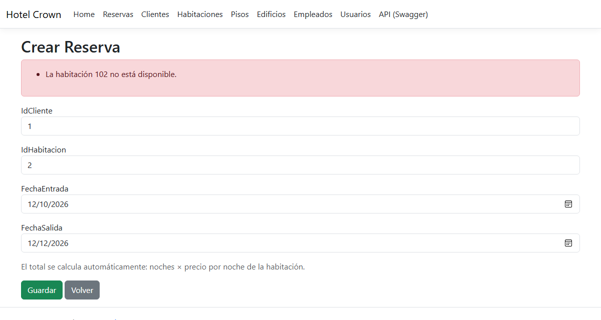

# Práctica de refactorización — Evidencias de verificación

**Sistema de Gestión de Reservas de Hoteles (Hotel Crown)**
Rama: `refactor/capa-api-y-desacoplamiento` · Entorno: .NET SDK 10.0.400, Windows 10

Los archivos de salida completos están en `docs/evidencias/`.

---

## 1. Compilación

```
dotnet build "Gestion del Hotel Crown.slnx" --no-incremental
```

```
Build succeeded.
    0 Warning(s)
    0 Error(s)
```

(Salida completa: `docs/evidencias/compilacion.txt`.)

## 2. Pruebas

```
dotnet test "Gestion del Hotel Crown.slnx"
```

```
Passed!  - Failed: 0, Passed: 21, Skipped: 0, Total: 21 - HotelManagement.Tests.dll
Passed!  - Failed: 0, Passed:  5, Skipped: 0, Total:  5 - HotelManagement.IntegrationTests.dll
```

| Proyecto | Prueba | Qué demuestra |
|---|---|---|
| Tests (sin BD) | `ReservaValida_SeGuarda_YCalculaElTotal` | Reserva **exitosa**: 3 noches × 80 = 240 |
| Tests (sin BD) | `FechasInvalidas_SeRechazan` (2 casos) | Rechazo: salida antes de la entrada / cero noches |
| Tests (sin BD) | `ReservaQueSeSolapa_SeRechaza` | Rechazo: habitación ya reservada en esas fechas |
| Tests (sin BD) | `HabitacionNoDisponible_SeRechaza` | Rechazo: habitación no disponible |
| Tests (sin BD) | `ClienteInexistente_SeRechaza`, `HabitacionInexistente_SeRechaza` | Rechazo: datos inexistentes |
| Tests (sin BD) | `ElTotalEnviadoPorElCliente_SeIgnora` | El total siempre lo calcula el negocio |
| Tests (sin BD) | `ReservaQueEmpiezaElDiaDeSalidaDeOtra_SePermite` | Caso límite permitido |
| Tests (sin BD) | `ActualizarUnaReserva_NoChocaConsigoMisma_YRecalculaTotal`, `ActualizarReservaInexistente_DevuelveFalse` | Reglas también al actualizar |
| Tests (sin BD) | `ReservaDominioTests` (9 casos) | Reglas de la entidad `Reserva` por sí sola |
| Tests (sin BD) | `ArquitecturaTests.CapaNoDependeDePersistencia` (2 casos) | BL y Entities no referencian DAL, EF ni SqlClient |
| Integración | `EsquemaSqlServer_EsIdenticoAlDeAntesDelRefactor` | **Compatibilidad del esquema** |
| Integración | `TablaReservas_ConservaSusColumnas` | Columnas de `Reservas` intactas |
| Integración | `ReservaValida_SeGuardaEnLaTablaReservas`, `ReservaSolapada_SeRechaza_YNoSeGuarda`, `Actualizar_YEliminar_UsanLosRepositoriosReales` | Flujo completo con los repositorios reales |

(Lista completa: `docs/evidencias/pruebas.txt`.)

---

## 3. Operación de reserva exitosa y rechazada

### 3.1 En la API (aplicación en ejecución)

Datos previos: cliente 1; habitación 1 (“101”, 80/noche, disponible); habitación 2 (“102”, no disponible).

**Reserva exitosa**

```http
POST /api/ReservaApi
{"idCliente":1,"idHabitacion":1,"fechaEntrada":"2026-12-01","fechaSalida":"2026-12-04"}
```
```
HTTP 201 Created
{"idReserva":1,"idCliente":1,"idHabitacion":1,"fechaEntrada":"2026-12-01T00:00:00",
 "fechaSalida":"2026-12-04T00:00:00","total":240.0,"noches":3}
```

**Reserva rechazada por regla de negocio (solapamiento)**

```http
POST /api/ReservaApi
{"idCliente":1,"idHabitacion":1,"fechaEntrada":"2026-12-03","fechaSalida":"2026-12-06"}
```
```
HTTP 422 Unprocessable Entity
{"title":"Regla de negocio violada","status":422,
 "detail":"La habitación 101 ya está reservada en esas fechas."}
```

Otros rechazos registrados (todos 422):

| Petición | Motivo devuelto |
|---|---|
| salida 2026-12-08 antes de entrada 2026-12-10 | “La fecha de salida debe ser posterior a la fecha de entrada.” |
| habitación 2 | “La habitación 102 no está disponible.” |
| cliente 99 | “El cliente 99 no existe.” |

(Salida completa de los 45 llamados a la API: `docs/evidencias/api-endpoints.txt`.)

### 3.2 En la interfaz web (MVC)

Al crear desde **Reservas → Nueva Reserva** con la habitación 102, el formulario no se guarda y muestra el motivo:



La reserva válida sí queda registrada, con el total calculado por el sistema:


---

## 4. Cómo se verificó que las reglas se prueban sin base de datos

1. **Por referencias de proyecto.** `HotelManagement.Tests.csproj` solo referencia `HotelManagement.BL` y `HotelManagement.Entities`. No referencia la DAL ni ningún paquete de Entity Framework, así que **no puede** abrir una base de datos aunque quisiera (ver `docs/evidencias/dependencias-proyectos.txt`).
2. **Por sustitución.** Las pruebas crean `ReservaBL` con repositorios falsos en memoria (`Fakes/RepositoriosEnMemoria.cs`) que implementan `IReservaRepositorio`, `IHabitacionRepositorio` e `IClienteRepositorio`. Esto solo es posible porque esas interfaces ahora pertenecen al negocio.
3. **Por prueba automática de arquitectura.** `ArquitecturaTests` inspecciona los ensamblados compilados de BL y Entities y falla si aparece una referencia a `HotelManagement.DAL`, `Microsoft.EntityFrameworkCore*` o `Microsoft.Data.SqlClient`.
4. **Por entorno de ejecución.** Las 21 pruebas terminan en unos 0,2 s en un equipo que no tiene SQL Server instalado: no hay ninguna base de datos a la que pudieran conectarse.

Comparación de dependencias:

```
ANTES   HotelManagement.BL -> HotelManagement.DAL, HotelManagement.Entities
DESPUÉS HotelManagement.BL -> HotelManagement.Entities
        HotelManagement.DAL -> HotelManagement.BL, HotelManagement.Entities, EF Core
```

---

## 5. Cómo se verificó la compatibilidad con el esquema actual

1. **Instantánea del esquema anterior.** Desde el commit previo al refactor (`f107cb3`) se generó, con `HotelDbContext.Database.GenerateCreateScript()` y el proveedor SQL Server, el script `CREATE TABLE` completo. Se guardó en `HotelManagement.IntegrationTests/Esquema/EsquemaSqlServer_AntesDelRefactor.sql`. No se necesita un servidor: EF genera el script a partir del modelo.
2. **Comparación automática.** `EsquemaSqlServer_EsIdenticoAlDeAntesDelRefactor` genera el mismo script con el código actual y exige que sea **idéntico** al anterior. Pasa.
3. **La prueba sí detecta cambios.** Se cambió temporalmente `ToTable("Reservas")` por `ToTable("Reserva")`: las dos pruebas de esquema fallaron (`Failed: 2`). Se revirtió el cambio.
4. **Flujo con repositorios reales.** `FlujoReservaConBaseDeDatosTests` crea las tablas con ese mismo modelo en SQLite y ejecuta crear, rechazar, actualizar y eliminar reservas a través de `ReservaRP`, `HabitacionRP` y `ClienteRP`.

Tabla de reservas (sin cambios):

```sql
CREATE TABLE [Reservas] (
    [IdReserva] int NOT NULL IDENTITY,
    [IdCliente] int NOT NULL,
    [IdHabitacion] int NOT NULL,
    [FechaEntrada] datetime2 NOT NULL,
    [FechaSalida] datetime2 NOT NULL,
    [Total] decimal(18,2) NOT NULL,
    CONSTRAINT [PK_Reservas] PRIMARY KEY ([IdReserva])
);
```

Las nuevas propiedades de dominio (`Noches`) son de solo lectura y no generan columnas.

---

## 6. Cómo reproducir

```bash
git checkout refactor/capa-api-y-desacoplamiento
dotnet build "Gestion del Hotel Crown.slnx"
dotnet test  "Gestion del Hotel Crown.slnx"
cd HotelApp.W && dotnet run --launch-profile http   # http://localhost:5280/swagger
```

En desarrollo la aplicación usa SQLite (`Crown.db`); en producción, SQL Server con `DefaultConnection` (configurable con `"DatabaseProvider"` en `appsettings*.json`).
