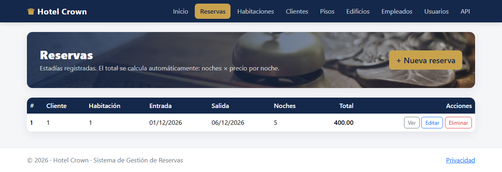

# Práctica de refactorización — Evidencias de verificación

**Sistema de Gestión de Reservas de Hoteles (Hotel Crown)**
Rama: `refactor/capa-api-y-desacoplamiento` · Entorno: .NET SDK 10.0.400, Windows 10 (sin SQL Server instalado)

Los archivos de salida completos están en `docs/evidencias/`.

---

## 1. Compilación

```
dotnet build "Gestion del Hotel Crown.slnx" --no-incremental
```

```
Build succeeded.
    0 Warning(s)
    0 Error(s)
```

(Salida completa: `docs/evidencias/compilacion.txt`.)

## 2. Pruebas

```
dotnet test "Gestion del Hotel Crown.slnx"
```

```
Passed!  - Failed: 0, Passed: 49, Skipped: 0, Total: 49 - HotelManagement.Tests.dll
Passed!  - Failed: 0, Passed: 16, Skipped: 0, Total: 16 - HotelManagement.IntegrationTests.dll
```

**65 pruebas, 0 fallos.** Lista completa con el nombre de cada prueba: `docs/evidencias/pruebas.txt`.

### 2.1 Pruebas sin base de datos (`HotelManagement.Tests`, 49)

| Clase | Pruebas | Qué demuestra |
|---|---|---|
| `ReglasReservaTests` | 18 | Flujo de reservas de `ReservaBL` con repositorios en memoria: reserva **exitosa** con total calculado (3 noches × 80 = 240); **rechazos** por fechas invertidas o iguales, fechas faltantes, cliente o habitación inexistente, habitación no disponible, precio inválido y **solapamiento**; caso límite permitido (entrar el día que otro sale); actualizar sin chocar consigo misma, chocando con **otra** reserva, cambiando de habitación (recalcula el total) o con la habitación ya no disponible; listar, obtener y eliminar. |
| `ReservaDominioTests` | 12 | Reglas de la entidad `Reserva` por sí sola: `Noches`, `SeSolapaCon` (7 casos), `ValidarDatos` y `CalcularTotal`. |
| `ValidacionEntidadesTests` | 9 | Validaciones declaradas en las entidades: campos obligatorios, correo, capacidad, precio, piso, salario, clave. |
| `ServiciosCrudTests` | 4 | `ClienteBL` y `HabitacionBL`: CRUD y la regla que impide borrar con reservas. |
| `ArquitecturaTests` | 6 | BL y Entities no referencian la DAL, EF ni SqlClient (en los ensamblados **y** en los `.csproj`), y ningún controlador usa la base de datos directamente. |

### 2.2 Pruebas de integración (`HotelManagement.IntegrationTests`, 16)

| Clase | Pruebas | Qué demuestra |
|---|---|---|
| `CompatibilidadEsquemaTests` | 2 | **Compatibilidad del esquema** (ver §5). |
| `FlujoReservaConBaseDeDatosTests` | 3 | Crear, rechazar, actualizar y eliminar reservas con los repositorios reales (EF) sobre SQLite. |
| `ApiHttpTests` | 11 | La API completa levantada en memoria: 201 con total calculado, 422 con el motivo (3 reglas), 400 por datos faltantes y precio negativo, 404, 400 por id distinto, 409 al borrar un cliente con reservas, CRUD completo y que `UsuarioApi` nunca devuelve la clave. |

### 2.3 Calidad de las pruebas

- **Cobertura** de las clases con reglas de negocio, medida con el recolector de Microsoft (`dotnet test --collect "Code Coverage"`): `Reserva`, `ReservaBL`, `ClienteBL` y `HabitacionBL` tienen **100 % de líneas y 100 % de ramas** cubiertas.
- **Prueba de mutación manual:** se introdujeron a propósito 4 errores en las reglas, uno por vez, y se ejecutaron las pruebas. Las pruebas detectaron los **4** (luego se restauró el código):

| Error introducido | Pruebas que fallaron |
|---|---|
| Solapamiento con `<=` (impide entrar el día que otro sale) | 2 |
| Se omite la comprobación de disponibilidad | 2 |
| Total sin multiplicar por las noches | 6 |
| Se acepta salida igual a entrada | 1 |

---

## 3. Operación de reserva exitosa y rechazada

### 3.1 En la API (aplicación en ejecución)

Datos previos: cliente 1; habitación 1 (“101”, 80/noche, disponible); habitación 2 (“102”, no disponible).

**Reserva exitosa**

```http
POST /api/ReservaApi
{"idCliente":1,"idHabitacion":1,"fechaEntrada":"2026-12-01","fechaSalida":"2026-12-04"}
```
```
HTTP 201 Created
{"idReserva":1,"idCliente":1,"idHabitacion":1,"fechaEntrada":"2026-12-01T00:00:00",
 "fechaSalida":"2026-12-04T00:00:00","total":240.0,"noches":3}
```

**Reserva rechazada por regla de negocio (solapamiento)**

```http
POST /api/ReservaApi
{"idCliente":1,"idHabitacion":1,"fechaEntrada":"2026-12-03","fechaSalida":"2026-12-06"}
```
```
HTTP 422 Unprocessable Entity
{"title":"Regla de negocio violada","status":422,
 "detail":"La habitación 101 ya está reservada en esas fechas."}
```

Otros rechazos registrados:

| Petición | Código | Motivo devuelto |
|---|---|---|
| Salida 2026-12-08 antes de entrada 2026-12-10 | 422 | “La fecha de salida debe ser posterior a la fecha de entrada.” |
| Habitación 2 | 422 | “La habitación 102 no está disponible.” |
| Cliente 99 | 422 | “El cliente 99 no existe.” |
| `DELETE /api/ClienteApi/1` (tiene una reserva) | 409 | “No se puede eliminar al cliente Luis Paz: tiene 1 reserva(s).” |
| `POST /api/HabitacionApi` con `precioNoche: -80` | 400 | “El precio por noche debe ser mayor que cero.” |

(Salida completa de las 55 llamadas a la API: `docs/evidencias/api-endpoints.txt`.)

### 3.2 En la interfaz web (MVC)

Al crear desde **Reservas → Nueva Reserva** con la habitación 102, el formulario no se guarda y muestra el motivo:


La reserva válida sí queda registrada, con el total calculado por el sistema (luego se cambió la salida al 06/12 y el total se recalculó a 400):



---

## 4. Cómo se verificó que las reglas se prueban sin base de datos

1. **Por referencias de proyecto.** `HotelManagement.Tests.csproj` solo referencia `HotelManagement.BL` y `HotelManagement.Entities`. No referencia la DAL ni ningún paquete de Entity Framework, así que **no puede** abrir una base de datos (ver `docs/evidencias/dependencias-proyectos.txt`).
2. **Por sustitución.** Las pruebas crean `ReservaBL`, `ClienteBL` y `HabitacionBL` con repositorios falsos en memoria (`Fakes/RepositoriosEnMemoria.cs`) que implementan las interfaces `IReservaRepositorio`, `IHabitacionRepositorio` e `IClienteRepositorio`. Esto solo es posible porque esas interfaces ahora pertenecen al negocio.
3. **Por prueba automática de arquitectura.** `ArquitecturaTests` falla si BL o Entities referencian `HotelManagement.DAL`, `Microsoft.EntityFrameworkCore*` o `Microsoft.Data.SqlClient`, tanto en el ensamblado compilado como en el archivo `.csproj`.
4. **Por entorno.** Las 49 pruebas terminan en unos 0,1–0,2 s en un equipo que **no tiene SQL Server instalado**.

Comparación de dependencias:

```
ANTES   HotelManagement.BL  -> HotelManagement.DAL, HotelManagement.Entities
DESPUÉS HotelManagement.BL  -> HotelManagement.Entities
        HotelManagement.DAL -> HotelManagement.BL, HotelManagement.Entities, EF Core
```

---

## 5. Cómo se verificó la compatibilidad con el esquema actual

1. **Línea base.** El código original del equipo (`f213dc3`) no podía generar un esquema: EF no encontraba las claves primarias (`IdCliente`, `IdReserva`…) y fallaba al construir el modelo. El primer commit de esta rama (`f107cb3`) solo declaró esas claves y la precisión de los decimales (`decimal(18,2)`, que es además el valor por defecto de SQL Server), **sin cambiar tablas ni columnas**. Desde ese commit se generó, con `HotelDbContext.Database.GenerateCreateScript()` y el proveedor SQL Server, el script `CREATE TABLE` completo, guardado en `HotelManagement.IntegrationTests/Esquema/EsquemaSqlServer_AntesDelRefactor.sql`.
2. **Comparación automática.** `EsquemaSqlServer_EsIdenticoAlDeAntesDelRefactor` genera el mismo script con el código actual y exige que sea **idéntico, línea por línea**. Pasa, incluso tras agregar las validaciones (`[Required]`, `[Range]`, `[EmailAddress]`), que no alteran el esquema.
3. **La prueba sí detecta cambios.** Se cambió temporalmente `ToTable("Reservas")` por `ToTable("Reserva")`: las dos pruebas de esquema fallaron (`Failed: 2`). Se revirtió el cambio.
4. **Flujo con repositorios reales.** `FlujoReservaConBaseDeDatosTests` y `ApiHttpTests` crean las tablas con ese mismo modelo en SQLite y ejecutan el flujo completo.
5. **Alcance.** La comparación se hace sobre el script SQL Server que EF genera a partir del modelo; no se ejecutó contra un servidor SQL Server real porque el equipo de pruebas no lo tiene. Como EF usa ese mismo modelo para leer y escribir, un script idéntico garantiza que las consultas siguen apuntando a las mismas tablas y columnas.

Tabla de reservas (sin cambios):

```sql
CREATE TABLE [Reservas] (
    [IdReserva] int NOT NULL IDENTITY,
    [IdCliente] int NOT NULL,
    [IdHabitacion] int NOT NULL,
    [FechaEntrada] datetime2 NOT NULL,
    [FechaSalida] datetime2 NOT NULL,
    [Total] decimal(18,2) NOT NULL,
    CONSTRAINT [PK_Reservas] PRIMARY KEY ([IdReserva])
);
```

Las nuevas propiedades de dominio (`Noches`) son de solo lectura y no generan columnas.

---

## 6. Cómo reproducir

```bash
git checkout refactor/capa-api-y-desacoplamiento
dotnet build "Gestion del Hotel Crown.slnx"
dotnet test  "Gestion del Hotel Crown.slnx"
cd HotelApp.W && dotnet run --launch-profile http   # http://localhost:5280/swagger
powershell -ExecutionPolicy Bypass -File ..\docs\demo-api.ps1   # 55 llamadas a la API
```

En desarrollo la aplicación usa SQLite (`Crown.db`); en producción, SQL Server con `DefaultConnection` (configurable con `"DatabaseProvider"` en `appsettings*.json`).
