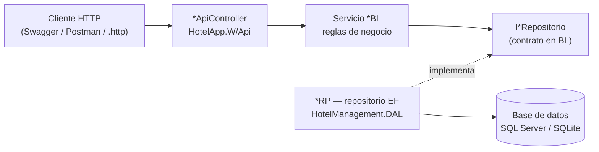
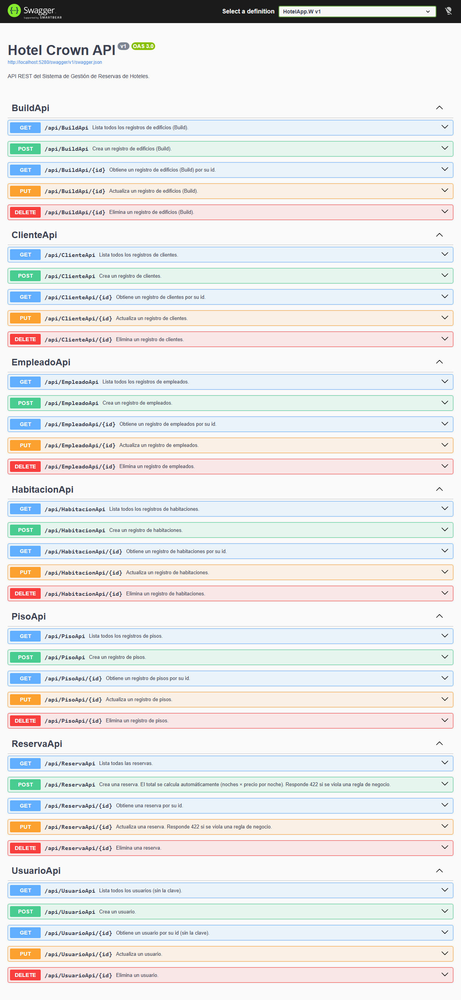

# Desarrollo de la capa de API — Hotel Crown

Rama: `refactor/capa-api-y-desacoplamiento` · Documentación interactiva: `http://localhost:5280/swagger`

---

## 1. Responsables por entidad

| Integrante | Entidades asignadas |
|---|---|
| *(completar)* | |
| *(completar)* | |
| *(completar)* | |

## 2. Arquitectura de la capa de API

Cada controlador de API recibe por inyección de dependencias el **servicio de negocio** de su entidad. El servicio, a su vez, usa el **repositorio** construido en la práctica anterior (`ClienteRP`, `ReservaRP`…), a través de la interfaz que define la capa de negocio.



| Entidad | Controlador | Servicio | Repositorio | Tabla |
|---|---|---|---|---|
| Edificio | `BuildApiController` | `BuildBL` | `BuildRP` | `Build` |
| Piso | `PisoApiController` | `PisoBL` | `PisoRP` | `Piso` |
| Habitación | `HabitacionApiController` | `HabitacionBL` | `HabitacionRP` | `Habitaciones` |
| Cliente | `ClienteApiController` | `ClienteBL` | `ClienteRP` | `Cliente` |
| Empleado | `EmpleadoApiController` | `EmpleadoBL` | `EmpleadoRP` | `Empleado` |
| Usuario | `UsuarioApiController` | `UsuarioBL` | `UsuarioRP` | `Usuario` |
| Reserva | `ReservaApiController` | `ReservaBL` | `ReservaRP` | `Reservas` |

## 3. Endpoints

Las 7 entidades exponen los mismos 5 métodos (35 endpoints en total). `{Entidad}` es `Build`, `Piso`, `Habitacion`, `Cliente`, `Empleado`, `Usuario` o `Reserva`.

| Método | Ruta | Acción | Respuestas |
|---|---|---|---|
| GET | `/api/{Entidad}Api` | Listar todos | 200 |
| GET | `/api/{Entidad}Api/{id}` | Obtener por id | 200 · 404 si no existe |
| POST | `/api/{Entidad}Api` | Crear | 201 + registro creado (encabezado `Location`) · 400 datos inválidos |
| PUT | `/api/{Entidad}Api/{id}` | Actualizar | 200 + registro · 400 si el id de la URL no coincide con el del cuerpo · 404 si no existe |
| DELETE | `/api/{Entidad}Api/{id}` | Eliminar | 204 · 404 si no existe |

**Particularidades**

- **Reserva:** `POST` y `PUT` aplican las reglas de negocio. Si se violan responden **422** con el motivo en `detail`:
  fechas inválidas, cliente o habitación inexistente, habitación no disponible, o habitación ya reservada en esas fechas. El `total` se calcula solo (noches × precio por noche).
- **Usuario:** la clave se recibe al crear o actualizar, pero **nunca se devuelve** en las respuestas.
- Validación automática (`[ApiController]`): tipos incorrectos o campos obligatorios faltantes devuelven **400** con el detalle de cada campo.

Cada endpoint está documentado en Swagger con su descripción y sus códigos de respuesta:



### Ejemplos

```http
POST /api/ClienteApi
{"nombre":"Luis","apellido":"Paz","cedula":"001-0000001-1","telefono":"809-555-0101","correo":"luis@example.com"}
→ 201 {"idCliente":1,"nombre":"Luis",...}

POST /api/ReservaApi
{"idCliente":1,"idHabitacion":1,"fechaEntrada":"2026-12-01","fechaSalida":"2026-12-04"}
→ 201 {"idReserva":1,...,"total":240.0,"noches":3}

POST /api/ReservaApi   (misma habitación, fechas que se cruzan)
→ 422 {"title":"Regla de negocio violada","detail":"La habitación 101 ya está reservada en esas fechas."}

GET /api/UsuarioApi
→ 200 [{"idUsuario":1,"nombreUsuario":"admin","rol":"Administrador"}]   (sin clave)
```

## 4. Resultado de las pruebas de los 35 endpoints

Se ejecutaron 45 llamadas (casos correctos y de error) contra la aplicación en ejecución. Resultado completo: `docs/evidencias/api-endpoints.txt`.

| Entidad | POST | GET (lista) | GET id | GET id inexistente | PUT | PUT id distinto | PUT inexistente | DELETE | DELETE inexistente |
|---|---|---|---|---|---|---|---|---|---|
| Build | 201 | 200 | 200 | 404 | 200 | 400 | 404 | 204 | 404 |
| Piso | 201 | 200 | 200 | – | 200 | – | – | – | 404 |
| Cliente | 201 | 200 | 200 | – | 200 | – | – | – | – |
| Empleado | 201 | 200 | 200 | 404 (tras borrar) | 200 | – | – | 204 | – |
| Habitación | 201 | 200 | 200 | – | 200 | – | – | – | – |
| Usuario | 201 | 200 | – | – | 200 | – | – | – | – |
| Reserva | 201 · **422** ×4 | 200 | 200 | – | 200 | – | 404 | 204 | – |

Además, 26 pruebas automáticas (`dotnet test`) pasan, incluidas las de reglas de reserva sin base de datos.

## 5. Cómo ejecutar y probar

```bash
cd HotelApp.W
dotnet run --launch-profile http
```

- **Swagger:** abrir `http://localhost:5280/swagger`, elegir un endpoint → *Try it out* → *Execute*.
- **Archivo `.http`:** `HotelApp.W/HotelApp.W.http` contiene una petición lista para cada endpoint (Visual Studio o la extensión *REST Client* de VS Code).
- **Script de demostración:** `powershell -ExecutionPolicy Bypass -File docs\demo-api.ps1 -Pausar` recorre los 35 endpoints en orden, mostrando método, cuerpo, código HTTP y respuesta, y espera *Enter* entre pasos (ideal para grabar el video).

## 6. Guion para el video explicativo (≈ 6–8 min)

1. **Introducción (30 s).** Proyecto, rama y entidades a cargo de cada integrante.
2. **Arquitectura (1 min).** Mostrar el diagrama de la sección 2 y abrir un controlador (p. ej. `ClienteApiController.cs`): recibe `IClienteBL`, que usa `ClienteRP`.
3. **Arrancar la API (30 s).** `dotnet run --launch-profile http` y abrir Swagger.
4. **Por cada entidad (≈ 40 s c/u), en este orden** para que existan los datos relacionados: Build → Piso → Cliente → Empleado → Habitación (crear la 101 disponible y la 102 no disponible) → Usuario → Reserva.
   - `POST` → 201 y el registro con su id.
   - `GET` lista y `GET /{id}` → 200.
   - `PUT` cambiando un campo → 200; repetir `GET /{id}` para ver el cambio.
   - `DELETE` de un id inexistente → 404 (y uno existente → 204, al final).
5. **Reserva (1,5 min).**
   - Exitosa: habitación 101, 01→04/12 → **201**, mostrar `total: 240`.
   - Rechazada: 03→06/12 → **422** “ya está reservada”; habitación 102 → **422** “no está disponible”.
   - `PUT` con salida 06/12 → total recalculado a 400.
6. **Usuario (20 s).** Mostrar que `GET` no devuelve la clave.
7. **Persistencia (20 s).** Detener y volver a iniciar la aplicación; `GET` sigue mostrando los datos.
8. **Cierre (20 s).** `dotnet test` → 26 pruebas correctas.
